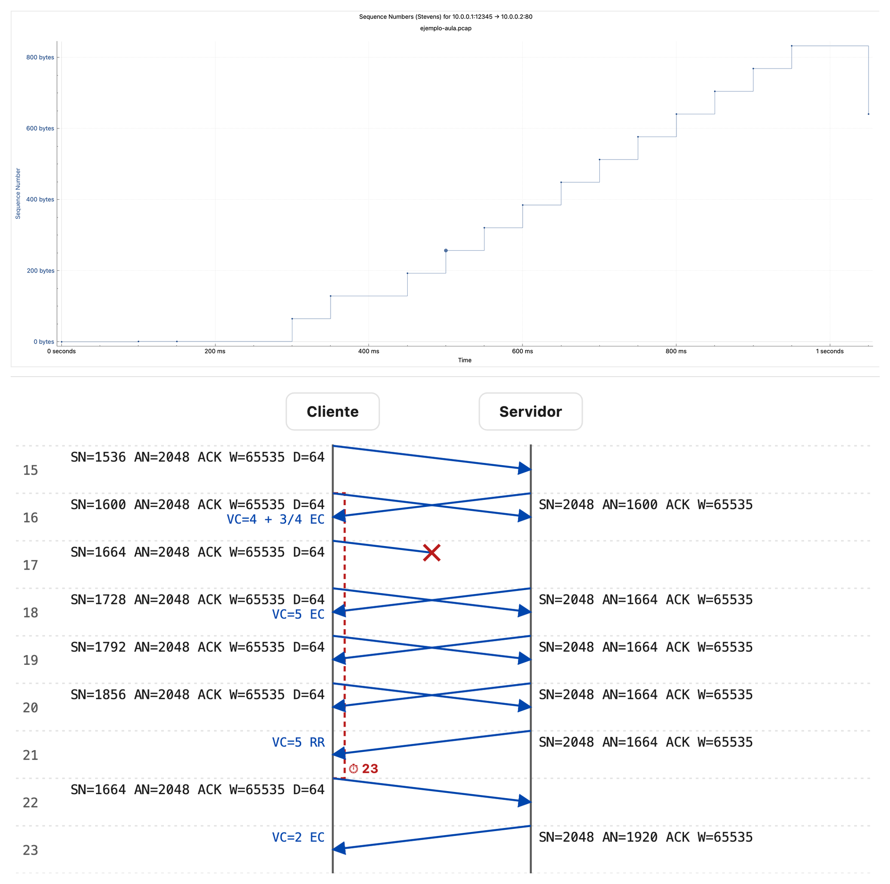

# TCP Trace Generator

[English](#english) | [Español](#español)



*Above, Wireshark's Stevens graph (Statistics › TCP Stream Graphs › Time/Sequence) of a capture generated in classroom mode; below, the diagram the script draws for the same capture. [Worked example](docs/diagrama-aula.md#english).*
*Arriba, el gráfico Stevens de Wireshark (Statistics › TCP Stream Graphs › Time/Sequence) de una captura generada en modo aula; debajo, el diagrama que el script dibuja para esa misma captura. [Ejemplo comentado](docs/diagrama-aula.md#español).*

---

<a name="english"></a>
## English

[](LICENSE) [](https://doi.org/10.5281/zenodo.23293176)

### Overview
`tcp_trace_generator.py` is a Python script based on Scapy that simulates a TCP connection. It generates a PCAP file containing the captured traffic and a CSV log detailing the internal state of the simulation (cwnd, ssthresh, RTO, etc.).

It implements **TCP Reno** (Slow Start, Congestion Avoidance, Fast Retransmit, Fast Recovery) and supports **TCP Tahoe**. It also features a special **Classroom Mode** designed for educational purposes, which enforces discrete time slots and predictable behavior.

Developed for the courses *Arquitectura de Redes I* (Bachelor's Degree in Telematics Engineering) and *Arquitectura de Redes* (Bachelor's Degrees in Computer Science Engineering and in Computer Engineering) at the University of Alcalá.

### Requirements
*   Python 3
*   Scapy (`pip install scapy`)

### Usage
```bash
python tcp_trace_generator.py [segments] [options]
```

### Installation and tests
The `Makefile` creates a virtual environment in `venv/`, installs the pinned dependencies and runs the test suite:
```bash
make install   # creates venv/ and installs requirements.txt
make test      # runs the unit tests in tests/ (unittest)
make clean     # removes venv/, test_output/ and generated files
```
The tests run the generator end to end and write their output to `test_output/`. One of them runs `tshark` (Wireshark's command-line analyser) on the generated traces and checks the labels Wireshark attaches to them (`TCP Dup ACK`, `TCP Fast Retransmission`, `TCP Retransmission` and its RTO); it is skipped when `tshark` is not installed.

### Parameters

| Argument | Type | Default | Description |
| :--- | :--- | :--- | :--- |
| `segments` | int | **Required** | Total number of data segments to send from client to server. |
| `--loss` | str | `""` | Comma-separated list of segment indices (1-based) to simulate as lost (dropped). Ranges are supported (e.g., `5,8-10`). |
| `--output`, `-o` | str | `tcp_reno_gen.pcap` | Filename for the output PCAP capture file. |
| `--rto-log` | str | `rto_log.txt` | Filename for the output CSV log file tracking internal TCP state. |
| `--initial-rto` | float | `1.0` | Initial Retransmission Timeout (RTO) value in seconds (Standard mode only). |
| `--accept-out-of-order` | flag | `False` | If set, the server accepts and buffers out-of-order segments (SACK-like behavior). If not set, they are discarded. |
| `--client-isn` | int | Random | Initial Sequence Number (ISN) for the Client. |
| `--server-isn` | int | `0` | Initial Sequence Number (ISN) for the Server. |
| `--client-mss` | int | `1460` | Maximum Segment Size (MSS) for the Client (sender). |
| `--server-mss` | int | `1460` | Maximum Segment Size (MSS) for the Server. |
| `--ssthresh` | str | `64` | Initial Slow Start Threshold. A plain number is segments; with a unit it is bytes, converted to whole client MSS: `64K` (or `64KB`) is 65536 B, 44 segments with MSS 1460, the classic 64 KB of the textbooks; `65535B` also gives 44. |
| `--client-rwnd` | int | `65535` | Initial Receiver Window (rwnd) for the Client. |
| `--server-rwnd` | int | `65535` | Receiver Window (rwnd) advertised by the Server. The sender never has more than `min(cwnd, rwnd)` bytes in flight. Must be at least one client MSS (zero-window probing is not simulated). |
| `--tcp-variant` | str | `reno` | TCP Congestion Control variant: `reno` or `tahoe`. |
| `--classroom` | flag | `False` | Enables **Classroom Mode**: discrete time slots, fixed RTO, fixed latencies, formatted for teaching. |
| `--classroom-rto-slots`| int | `3` | (Classroom Mode only) The fixed RTO value expressed in number of time slots. |
| `--diagram` | str | — | (Classroom Mode only) Writes a tick-by-tick sequence diagram of the exchanged segments as an SVG file. See [Classroom diagram](#classroom-diagram). |
| `--diagram-lang`, `--lang` | str | `es` | Language of the diagram and summary labels: `es` (Cliente/Servidor, `VC`, modes AL/EC/RR) or `en` (Client/Server, `cwnd`, modes SS/CA/FR). |
| `--client-ip` | str | `10.0.0.1` | IPv4 address of the client (sender). See [Endpoints](#endpoints). |
| `--server-ip` | str | `10.0.0.2` | IPv4 address of the server (receiver). |
| `--client-port` | int | `12345` | TCP port of the client. |
| `--server-port` | int | `80` | TCP port of the server. |
| `--close` | str | `none` | How the connection ends after the last ACK: `none`, `fin` (FIN, ACK, FIN, ACK) or `fin3` (FIN, FIN+ACK, ACK). See [Connection close](#connection-close). |
| `--bandwidth` | str | — | (Standard mode only) Link bandwidth in bit/s (`1000000`, `1M`, `10Mbps`, `512k`): frames of the same host are serialized one after another instead of leaving at the same instant. See [Link bandwidth](#link-bandwidth). |
| `--summary` | str | — | Writes a CSV with one row per burst (one per RTT in the usual case): frames, new and retransmitted segments, segments in flight, cwnd, ssthresh and mode. See [Per-burst summary](#per-burst-summary). |
| `--start-time` | int | now | Absolute time of the SYN in Unix seconds. Timestamps are whole microseconds relative to it, so the relative times never change between runs; fixing it also makes the pcap identical byte for byte. |
| `--rtt-log` | str | — | Writes a CSV with every RTT sample and RTO computation (RFC 6298), with the conventions used stated in its header. See [RTT and RTO log](#rtt-and-rto-log). |

### Operating Modes

#### 1. Standard Mode (Default)
Simulates a realistic TCP implementation, following standard RFCs (closest to Linux behavior).
*   **Continuous Time:** Events occur at precise floating-point timestamps based on processing and propagation delays. No artificial quantization.
*   **Dynamic RTO:**
    *   Calculated per RFC 6298 using RTT samples from the simulation.
    *   Update logic: `SRTT = 7/8 SRTT + 1/8 SampleRTT`, `RTTVAR = 3/4 RTTVAR + 1/4 |SampleRTT - SRTT|`.
    *   Formula: `RTO = SRTT + 4 * RTTVAR` (min 0.2s).
    *   **Karn's Algorithm:** RTT samples are ignored for retransmitted segments to prevent ambiguous measurements.
*   **Flow Control:** The send window is `min(cwnd, rwnd)` (RFC 5681 §3.1), with rwnd taken from the last ACK received. While rwnd is the bottleneck, cwnd is not increased (RFC 7661) and the log marks those ACKs as `rwnd-limited`.
*   **Timeout Recovery:** After an RTO every outstanding segment is considered lost (RFC 6298 §5.4). The sender rewinds to the oldest unacknowledged segment and retransmits from there in Slow Start, as cwnd allows, until everything is acknowledged (also when all the data had already been sent once and the tail of the transfer was discarded by the receiver). A single loss therefore costs at most one timeout.
*   **ACK Generation Rules:**
    *   **Delayed ACK:** Standard mechanism. Waits for 2 full segments or `DELAYED_ACK_TIMEOUT` (0.2s).
    *   **Immediate ACK:** Sent immediately on Out-of-Order arrival (Duplicate ACKs) to trigger Fast Retransmit strategies.
    *   **Constant Advertised Window:** The receiver always advertises `--server-rwnd`, even while buffering out-of-order data. RFC 5681 (and Wireshark) only count an ACK as a duplicate if its window is unchanged, so this keeps "TCP Dup ACK" and "Fast Retransmission" visible in the capture.
*   **Concurrency:** Packets are processed with varying inter-arrival times; bursts are processed as fast as the "wire" allows.

#### 2. Classroom Mode (`--classroom`)
Designed to generate clean, predictable traces for ease of analysis in manual exercises.
*   **Discrete Time Slots:** The simulation runs in discrete steps of `Slot_Duration`. All events (transmission start, arrival) align to the grid.
    *   `Slot_Duration = RTT / 2`
*   **Strict Serialization:** Transmission of multiple packets is serialized across consecutive slots. A sender cannot "burst" multiple packets in the same time instant.
*   **Fixed Latency:** Propagation delay is fixed at `RTT / 4`.
*   **RTO Constraints:**
    *   The RTO is **Fixed** and does not adapt.
    *   Value: `classroom-rto-slots * Slot_Duration` (Default: 3 slots).
    *   The timer restarts strictly on every new acknowledgment.
*   **ACK Generation Rules:**
    *   **Delayed ACK:** Enabled. The receiver waits for 2 full segments or a timeout.
    *   **Timeout Alignment:** The Delayed ACK timer is set to exactly `1 Slot`.
    *   **Immediate ACK on Gap Fill:** Crucial for exercises. If an out-of-order segment arrives and "fills a gap" in the receive buffer, an **Immediate Cumulative ACK** is generated, bypassing the Delayed ACK timer. This ensures fast recovery responsiveness in the traces.
    *   **Determinism:** Arrival events are prioritized over Timer events when occurring in the same slot.

### Classroom diagram
With `--classroom`, the `--diagram FILE.svg` option draws the exchange as a tick diagram in the same style as the *Secuencias TCP* exercises of the course: one tick per time slot, two lifelines (Cliente / Servidor), each segment as an arrow that leaves at the start of its tick and arrives half a tick later, labelled `SN=… AN=… flags W=… MSS=… D=…` next to its origin. Lost segments stop half way with a red ✕. The sender's congestion window is written where it changes (`VC=4 + 1/4 EC`, with modes AL, EC and RR; with `--diagram-lang en`, `cwnd=4 + 1/4 CA` and modes SS, CA and FR), and a red brace on the client side shows the retransmission timer behind each loss: solid up to the timeout, dashed if a fast retransmission came first, labelled with the tick in which it expires (⏱). The diagram is the reference of what should be seen in the capture: open the pcap in Wireshark next to the SVG and match each segment. Sequence numbers are absolute, as in the capture with relative numbering disabled. A complete worked example, with the diagram, the capture and a tick-by-tick reading, is in [docs/diagrama-aula.md](docs/diagrama-aula.md#english).

```bash
python tcp_trace_generator.py 14 --classroom --loss 11 --accept-out-of-order --ssthresh 2 \
  --client-isn 1024 --server-isn 2047 --client-mss 64 --server-mss 128 --diagram ejemplo.svg
```

### Endpoints
`--client-ip`, `--server-ip`, `--client-port` and `--server-port` set the addresses and ports of both ends. The client is always the sender of the data and the one that opens (SYN) and closes (first FIN) the connection; the server acknowledges. The same endpoints are written in the header of the CSV files that describe the capture (`--summary`, `--rtt-log`), so a trace generated for an exercise with its own addressing plan needs no post-processing. Both addresses must be valid IPv4 addresses and must differ. The MAC addresses are fixed (`00:00:00:00:00:01` client, `00:00:00:00:00:02` server).

### Connection close
By default the capture ends with the last ACK. With `--close fin` the client closes the connection one RTT after that ACK with the usual four segments: `FIN` from the client, `ACK` from the server, `FIN` from the server 10 ms later and the final `ACK` from the client. `--close fin3` folds the server's two segments into one `FIN+ACK` (three-segment close). The FIN consumes one sequence number on each side, so the last ACK acknowledges `ISN + data + 1`. In classroom mode the close segments go in the next free slots, and the diagram shows them. The close is never lost or retransmitted. The state log records the events `FIN Sent`, `FIN Acked` and `FIN Received`.

### Link bandwidth
In standard mode every host puts its frames on the wire as soon as they are ready, so a burst of segments leaves at the same instant. `--bandwidth` gives each host a link of that capacity: a frame cannot start until the previous one from the same host has been fully serialized (`length in bits / bandwidth`; a 1514-byte frame takes 12.1 ms at 1 Mbit/s), and it reaches the other end after its serialization time plus the propagation delay (`RTT / 2`). The capture is taken at the client: client frames are stamped when their transmission starts and server frames (the SYN+ACK included) when they have arrived. This spreads the bursts in the Stevens graph and delays the ACKs accordingly, so RTT samples grow with the burst size, as in a real network. Accepted units: `1000000`, `1M`, `10Mbps`, `512k`, `1G`. It does not apply to classroom mode, where every segment already takes one slot.

### Per-burst summary
`--summary FILE.csv` writes one row per burst of data segments: consecutive data segments from the client with no ACK arriving at the client and no timeout in between. In the usual case that is one row per RTT, which is how the exercises count things. The columns (in Spanish by default, in English with `--lang en`) are:

| Column | Meaning |
| :--- | :--- |
| `Rafaga` / `Burst` | Burst number. |
| `Tramas` / `Frames` | Frame numbers of the segments in the capture (`first-last`), as Wireshark numbers them. |
| `Tiempo` / `Time` | Departure time of the first segment (seconds since the SYN). |
| `Segmentos` / `Segments` | Segments in the burst. |
| `Nuevos` / `New` | Segments sent for the first time. |
| `Retransmitidos` / `Retransmitted` | Segments that had already been sent before. |
| `EnVuelo` / `InFlight` | Segments in flight when the last segment of the burst leaves: `(SND.NXT − SND.UNA) / MSS`. During fast recovery this includes the lost segment and the segments the receiver has buffered. |
| `VC` / `cwnd` | Congestion window in segments, in the notation of the exercises (`4 + 2/4` in congestion avoidance). |
| `Umbral` / `ssthresh` | Slow start threshold in segments. |
| `Modo` / `Mode` | Sender mode when the burst leaves: `AL`/`EC`/`RR` (`SS`/`CA`/`FR` in English). |

The file starts with comment lines (`#`) that state the endpoints, the MSS and these conventions; skip them when loading it (`pandas.read_csv(..., comment='#')`). For the [worked example](docs/ejemplo-estandar-resumen.csv) the slow start rows show 1, 2, 4 and 8 new segments per RTT, then a burst of four segments in fast recovery (the retransmission plus three new ones, with `VC=11` and `Umbral=4`) and congestion avoidance from there.

### RTT and RTO log
`--rtt-log FILE.csv` records every RTT sample and every RTO computation of the sender, with the arithmetic written out in the `Calc` column so that a student can check it by hand. The conventions, also written in the header of the file, are:
*   Times are seconds since the client's SYN, as seen at the client (the capture point).
*   One sample per new ACK, measured on the oldest unacknowledged segment (`SND.UNA`): `SampleRTT` = arrival time of the ACK that covers it − time of its **first** transmission. A cumulative ACK yields one sample, not one per segment.
*   Karn's algorithm: if the oldest unacknowledged segment had been retransmitted, the ACK yields no sample and the RTO is left as it is (`No sample (Karn)` row).
*   First sample: `SRTT = SampleRTT`, `RTTVAR = SampleRTT / 2`. Afterwards `RTTVAR = 3/4 · RTTVAR + 1/4 · |SRTT − SampleRTT|` (with the old SRTT), then `SRTT = 7/8 · SRTT + 1/8 · SampleRTT`.
*   `RTO = SRTT + max(G, 4 · RTTVAR)` with `G = 0.1 s`, and then `RTO = max(RTO, 0.2 s)`.
*   On a retransmission timeout the RTO is doubled (`Backoff` row). The next valid sample recomputes it.
*   In classroom mode the RTO is fixed and the log has a single `Fixed RTO (classroom)` row.

The columns are `Time, Event, Seq, SentAt, SampleRTT, SRTT, RTTVAR, RTO, Calc`. The `RTO` column is the value the state log (`--rto-log`) shows at the same instant. [Example](docs/ejemplo-estandar-rtt.csv).

### Worked example in standard mode
The traces of the course exercises on slow start, fast retransmit and congestion avoidance are generated with a single command, with the addressing and the orderly close of the exercise statement and no post-processing:
```bash
python tcp_trace_generator.py 40 --loss 8 --accept-out-of-order \
  --client-isn 2233445566 --server-isn 3344556677 \
  --client-ip 10.0.0.2 --server-ip 10.0.0.1 --close fin \
  -o docs/ejemplo-estandar.pcap --rto-log docs/ejemplo-estandar-estado.csv \
  --summary docs/ejemplo-estandar-resumen.csv --rtt-log docs/ejemplo-estandar-rtt.csv
```
The result is in `docs/`: the [capture](docs/ejemplo-estandar.pcap) (73 frames: handshake, slow start up to 8 segments per RTT, segment 8 lost, seven duplicate ACKs, fast retransmission, congestion avoidance and the four-segment close), the [state log](docs/ejemplo-estandar-estado.csv), the [per-burst summary](docs/ejemplo-estandar-resumen.csv) and the [RTT/RTO log](docs/ejemplo-estandar-rtt.csv). Opened in Wireshark, frames 23 to 29 are labelled `TCP Dup ACK #1` to `#7` and frame 30 `TCP Fast Retransmission`. The RTO scenario of the same exercises is `24 --loss 8-15 --close fin`: segments 8 to 15 are lost in one burst, no duplicate ACK arrives and Wireshark labels the eight retransmissions after the timeout as `TCP Retransmission`, with an RTO equal to the one in the log.

### Examples

#### 1. Basic Simulation (Standard Mode)
Send 20 segments with no loss.
```bash
python tcp_trace_generator.py 20
```

#### 2. Fast Retransmit Scenario
Send 20 segments, losing segment 10.
```bash
python tcp_trace_generator.py 20 --loss 10
```

#### 3. Classroom Exercise (Complex)
Classroom mode with discrete slots, fixed RTO (4 slots), custom ISNs, small MSS, and packet loss to demonstrate recovery.
```bash
python tcp_trace_generator.py 14 \
  --classroom \
  --classroom-rto-slots 4 \
  --loss 11 \
  --accept-out-of-order \
  --client-isn 1024 --server-isn 2047 \
  --client-mss 64 --server-mss 128 \
  --ssthresh 2
```

### Authors
Departamento de Automática, Universidad de Alcalá:
*   Enrique de la Hoz — [ORCID 0000-0003-4837-3837](https://orcid.org/0000-0003-4837-3837)
*   Sandra Machado Zurita — [ORCID 0000-0002-5746-3597](https://orcid.org/0000-0002-5746-3597)
*   Luis de la Cruz Piris — [ORCID 0000-0002-9570-2851](https://orcid.org/0000-0002-9570-2851)

### How to cite
If you use this tool, please cite it (APA, generated from [`CITATION.cff`](CITATION.cff)):

> de la Hoz, E., Machado Zurita, S., & de la Cruz Piris, L. (2026). *TCP Trace Generator* (Version 1.0.1) [Computer software]. Universidad de Alcalá. https://doi.org/10.5281/zenodo.23293176

### License
This project is released under the [MIT License](LICENSE).
Copyright (c) 2025 Enrique de la Hoz, Sandra Machado Zurita, Luis de la Cruz Piris.

---

<a name="español"></a>
## Español

[](LICENSE) [](https://doi.org/10.5281/zenodo.23293176)

### Descripción General
`tcp_trace_generator.py` es un script de Python basado en Scapy que simula una conexión TCP completa. Genera un archivo PCAP con el tráfico capturado y un log CSV que detalla el estado interno de la simulación (cwnd, ssthresh, RTO, etc.).

Implementa los algoritmos **TCP Reno** (Slow Start, Congestion Avoidance, Fast Retransmit, Fast Recovery) y soporta **TCP Tahoe**. Además, incluye un **Modo Classroom (Docente)** diseñado para la enseñanza, que fuerza el uso de ranuras de tiempo discretas y comportamientos predecibles.

Desarrollado para las asignaturas Arquitectura de Redes I (Grado en Ingeniería Telemática) y Arquitectura de Redes (Grado en Ingeniería Informática y Grado en Ingeniería de Computadores) de la Universidad de Alcalá.

### Requisitos
*   Python 3
*   Scapy (`pip install scapy`)

### Uso
```bash
python tcp_trace_generator.py [segmentos] [opciones]
```

### Instalación y pruebas
El `Makefile` crea un entorno virtual en `venv/`, instala las dependencias fijadas y ejecuta la suite de pruebas:
```bash
make install   # crea venv/ e instala requirements.txt
make test      # ejecuta las pruebas unitarias de tests/ (unittest)
make clean     # elimina venv/, test_output/ y los ficheros generados
```
Las pruebas ejecutan el generador de principio a fin y escriben su salida en `test_output/`. Una de ellas pasa `tshark` (el analizador de línea de órdenes de Wireshark) sobre las trazas generadas y comprueba las etiquetas que Wireshark les asigna (`TCP Dup ACK`, `TCP Fast Retransmission`, `TCP Retransmission` y su RTO); se omite si `tshark` no está instalado.

### Parámetros

| Argumento | Tipo | Por defecto | Descripción |
| :--- | :--- | :--- | :--- |
| `segmentos` | int | **Requerido** | Número total de segmentos de datos a enviar del cliente al servidor. |
| `--loss` | str | `""` | Lista separada por comas de índices de segmentos (base-1) que se perderán. Soporta rangos (ej. `5,8-10`). |
| `--output`, `-o` | str | `tcp_reno_gen.pcap` | Nombre del archivo PCAP de salida. |
| `--rto-log` | str | `rto_log.txt` | Nombre del archivo de log CSV para trazar el estado interno de TCP. |
| `--initial-rto` | float | `1.0` | Valor inicial del Retransmission Timeout (RTO) en segundos (Solo modo estándar). |
| `--accept-out-of-order` | flag | `False` | Si se activa, el servidor acepta y almacena en buffer segmentos fuera de orden. Si no, los descarta. |
| `--client-isn` | int | Aleatorio | Número de Secuencia Inicial (ISN) del Cliente. |
| `--server-isn` | int | `0` | Número de Secuencia Inicial (ISN) del Servidor. |
| `--client-mss` | int | `1460` | Tamaño Máximo de Segmento (MSS) del Cliente (emisor). |
| `--server-mss` | int | `1460` | Tamaño Máximo de Segmento (MSS) del Servidor. |
| `--ssthresh` | str | `64` | Umbral inicial de Slow Start. Un número sin unidad son segmentos; con unidad son octetos y se convierten a MSS enteros del cliente: `64K` (o `64KB`) son 65536 B, 44 segmentos con MSS 1460, los 64 KB clásicos de los libros de texto; `65535B` también da 44. |
| `--client-rwnd` | int | `65535` | Ventana de Recepción inicial (rwnd) del Cliente. |
| `--server-rwnd` | int | `65535` | Ventana de Recepción (rwnd) anunciada por el Servidor. El emisor nunca tiene más de `min(cwnd, rwnd)` bytes en vuelo. Debe ser al menos un MSS del cliente (no se simula la sonda de ventana cero). |
| `--tcp-variant` | str | `reno` | Variante de TCP: `reno` o `tahoe`. |
| `--classroom` | flag | `False` | Activa el **Modo Classroom**: tiempo discreto, RTO fijo, latencias fijas, diseñado para ejercicios de clase. |
| `--classroom-rto-slots`| int | `3` | (Solo Modo Classroom) El valor fijo del RTO expresado en número de ranuras de tiempo. |
| `--diagram` | str | — | (Solo Modo Classroom) Escribe un diagrama de secuencia tic a tic con los segmentos intercambiados en un fichero SVG. Véase [Diagrama del modo aula](#diagrama-del-modo-aula). |
| `--diagram-lang`, `--lang` | str | `es` | Idioma de los rótulos del diagrama y del resumen: `es` (Cliente/Servidor, `VC`, modos AL/EC/RR) o `en` (Client/Server, `cwnd`, modos SS/CA/FR). |
| `--client-ip` | str | `10.0.0.1` | Dirección IPv4 del cliente (emisor). Véase [Extremos](#extremos). |
| `--server-ip` | str | `10.0.0.2` | Dirección IPv4 del servidor (receptor). |
| `--client-port` | int | `12345` | Puerto TCP del cliente. |
| `--server-port` | int | `80` | Puerto TCP del servidor. |
| `--close` | str | `none` | Cómo termina la conexión tras el último ACK: `none`, `fin` (FIN, ACK, FIN, ACK) o `fin3` (FIN, FIN+ACK, ACK). Véase [Cierre de la conexión](#cierre-de-la-conexión). |
| `--bandwidth` | str | — | (Solo modo estándar) Ancho de banda del enlace en bit/s (`1000000`, `1M`, `10Mbps`, `512k`): las tramas de un mismo equipo se serializan una tras otra en lugar de salir en el mismo instante. Véase [Ancho de banda del enlace](#ancho-de-banda-del-enlace). |
| `--summary` | str | — | Escribe un CSV con una fila por ráfaga (una por RTT en el caso habitual): tramas, segmentos nuevos y retransmitidos, segmentos en vuelo, VC, umbral y modo. Véase [Resumen por ráfaga](#resumen-por-ráfaga). |
| `--start-time` | int | ahora | Instante absoluto del SYN en segundos Unix. Las marcas de tiempo son microsegundos enteros respecto a él, así que los tiempos relativos no cambian de una ejecución a otra; si se fija, el pcap sale idéntico byte a byte. |
| `--rtt-log` | str | — | Escribe un CSV con cada muestra de RTT y cada cálculo del RTO (RFC 6298), con las convenciones empleadas en su cabecera. Véase [Registro de RTT y RTO](#registro-de-rtt-y-rto). |

### Modos de Funcionamiento
#### 1. Modo Estándar (Por defecto)
Simula una implementación TCP realista, siguiendo los RFCs estándar (comportamiento cercano a Linux).
*   **Tiempo Continuo:** Los eventos ocurren en instantes precisos (floating-point) basados en retardos de procesamiento y propagación. Sin cuantificación artificial.
*   **RTO Dinámico:**
    *   Calculado según RFC 6298 usando las muestras de RTT de la simulación.
    *   Lógica: `SRTT = 7/8 SRTT + 1/8 MuestraRTT`, `RTTVAR = 3/4 RTTVAR + 1/4 |MuestraRTT - SRTT|`.
    *   Fórmula: `RTO = SRTT + 4 * RTTVAR` (mínimo 0.2s).
    *   **Algoritmo de Karn:** Las muestras de RTT se ignoran para segmentos retransmitidos para evitar mediciones ambiguas.
*   **Control de Flujo:** La ventana de envío es `min(cwnd, rwnd)` (RFC 5681 §3.1), con rwnd tomada del último ACK recibido. Mientras rwnd sea el cuello de botella, cwnd no crece (RFC 7661) y el registro marca esos ACK como `rwnd-limited`.
*   **Recuperación tras Timeout:** Tras un RTO se consideran perdidos todos los segmentos pendientes (RFC 6298 §5.4). El emisor retrocede al segmento más antiguo sin confirmar y retransmite desde ahí en Slow Start, según permita cwnd, hasta que todo queda confirmado (también cuando todos los datos ya se habían enviado una vez y el receptor descartó la cola de la transferencia). Una pérdida aislada cuesta como máximo un timeout.
*   **Reglas de Generación de ACKs:**
    *   **ACK Retardado:** Mecanismo estándar. Espera confirmación de 2 segmentos o un timeout de `DELAYED_ACK_TIMEOUT` (0.2s).
    *   **ACK Inmediato:** Se envía inmediatamente al recibir segmentos fuera de orden (Duplicate ACK) para disparar el Fast Retransmit.
    *   **Ventana Anunciada Constante:** El receptor anuncia siempre `--server-rwnd`, incluso mientras almacena datos fuera de orden. RFC 5681 (y Wireshark) solo consideran duplicado un ACK si su ventana no cambia, de modo que así se conservan las etiquetas "TCP Dup ACK" y "Fast Retransmission" en la captura.
*   **Concurrencia:** Los paquetes se procesan con tiempos de llegada variables; las ráfagas ocurren tan rápido como la "red" lo permita.

#### 2. Modo Classroom (Docente) (`--classroom`)
Diseñado para generar trazas limpias y predecibles, ideales para realizar ejercicios a mano.
*   **Ranuras de Tiempo Discretas (Slots):** La simulación avanza en pasos fijos de `Duración_Slot`. Todos los eventos (inicio de tx, llegada) se alinean a la rejilla.
    *   `Duración_Slot = RTT / 2`
*   **Serialización Estricta:** La transmisión de múltiples paquetes se serializa en ranuras consecutivas. Un emisor no puede enviar una "ráfaga" instantánea.
*   **Latencia Fija:** El retardo de propagación (ida) se fija en `RTT / 4`.
*   **Restricciones de RTO:**
    *   El RTO es **Fijo** y no se adapta con medidas.
    *   Valor: `classroom-rto-slots * Duración_Slot` (Por defecto: 3 ranuras).
    *   El temporizador se reinicia estrictamente con cada nuevo asentimiento recibido.
*   **Reglas de Generación de ACKs:**
    *   **ACK Retardado:** Activado. El receptor espera 2 segmentos completos o un timeout.
    *   **Alineación del Timeout:** El temporizador de ACK retardado dura exactamente `1 Slot`.
    *   **ACK Inmediato por Relleno de Huecos:** Fundamental para ejercicios. Si llega un segmento desordenado que "rellena un hueco" en el buffer de recepción, se genera un **ACK Acumulativo Inmediato**, ignorando el temporizador. Esto facilita ver la recuperación rápida en la traza.
    *   **Determinismo:** Los eventos de llegada tienen prioridad sobre los temporizadores si ocurren en el mismo instante.

### Diagrama del modo aula
Con `--classroom`, la opción `--diagram FICHERO.svg` dibuja el intercambio como un diagrama de tics con el mismo estilo que los ejercicios de *Secuencias TCP* de la asignatura: un tic por ranura de tiempo, dos líneas de vida (Cliente / Servidor), cada segmento como una flecha que sale al comienzo de su tic y llega medio tic después, rotulada `SN=… AN=… flags W=… MSS=… D=…` junto a su origen. Los segmentos perdidos se cortan a mitad de camino con una ✕ roja. La ventana de congestión del emisor se escribe donde cambia (`VC=4 + 1/4 EC`, con los modos AL, EC y RR; con `--diagram-lang en`, `cwnd=4 + 1/4 CA` y los modos SS, CA y FR), y una llave roja en el lado del cliente muestra el temporizador de retransmisión que hay detrás de cada pérdida: continua hasta el vencimiento, punteada si antes llegó una retransmisión rápida, con el tic en que vence (⏱). El diagrama es la referencia de lo que debe observarse en la captura: ábrase el pcap en Wireshark junto al SVG y cotéjese segmento a segmento. Los números de secuencia son absolutos, como en la captura con la numeración relativa desactivada. Hay un ejemplo completo, con el diagrama, la captura y la lectura tic a tic, en [docs/diagrama-aula.md](docs/diagrama-aula.md#español).

```bash
python tcp_trace_generator.py 14 --classroom --loss 11 --accept-out-of-order --ssthresh 2 \
  --client-isn 1024 --server-isn 2047 --client-mss 64 --server-mss 128 --diagram ejemplo.svg
```

### Extremos
`--client-ip`, `--server-ip`, `--client-port` y `--server-port` fijan las direcciones y los puertos de ambos extremos. El cliente es siempre el que envía los datos y el que abre (SYN) y cierra (primer FIN) la conexión; el servidor asiente. Los mismos extremos se escriben en la cabecera de los CSV que describen la captura (`--summary`, `--rtt-log`), de modo que una traza generada para un enunciado con su propio plan de direccionamiento no necesita posprocesado. Ambas direcciones deben ser IPv4 válidas y distintas. Las direcciones MAC son fijas (`00:00:00:00:00:01` cliente, `00:00:00:00:00:02` servidor).

### Cierre de la conexión
Por defecto la captura termina con el último ACK. Con `--close fin` el cliente cierra la conexión un RTT después de ese ACK con los cuatro segmentos habituales: `FIN` del cliente, `ACK` del servidor, `FIN` del servidor 10 ms después y `ACK` final del cliente. `--close fin3` funde los dos segmentos del servidor en un único `FIN+ACK` (cierre en tres segmentos). El FIN consume un número de secuencia en cada sentido, así que el último ACK confirma `ISN + datos + 1`. En modo aula los segmentos del cierre ocupan las siguientes ranuras libres y aparecen en el diagrama. El cierre nunca se pierde ni se retransmite. El registro de estado anota los eventos `FIN Sent`, `FIN Acked` y `FIN Received`.

### Ancho de banda del enlace
En modo estándar cada equipo pone sus tramas en el medio en cuanto están listas, así que una ráfaga de segmentos sale en el mismo instante. `--bandwidth` da a cada equipo un enlace de esa capacidad: una trama no puede empezar hasta que la anterior del mismo equipo se ha serializado por completo (`longitud en bits / ancho de banda`; una trama de 1514 bytes tarda 12,1 ms a 1 Mbit/s) y llega al otro extremo tras su tiempo de serialización más el retardo de propagación (`RTT / 2`). La captura se toma en el cliente: sus tramas llevan el instante en que empieza su transmisión y las del servidor (también el SYN+ACK), el de su llegada. Así las ráfagas se extienden en el gráfico Stevens y los ACK se retrasan en consecuencia, con lo que las muestras de RTT crecen con el tamaño de la ráfaga, como en una red real. Unidades admitidas: `1000000`, `1M`, `10Mbps`, `512k`, `1G`. No se aplica al modo aula, donde cada segmento ya ocupa una ranura.

### Resumen por ráfaga
`--summary FICHERO.csv` escribe una fila por ráfaga de segmentos de datos: segmentos de datos consecutivos del cliente sin que llegue un ACK al cliente ni venza el temporizador entre ellos. En el caso habitual es una fila por RTT, que es como se cuentan las cosas en los ejercicios. Las columnas (en español por defecto, en inglés con `--lang en`) son:

| Columna | Significado |
| :--- | :--- |
| `Rafaga` / `Burst` | Número de ráfaga. |
| `Tramas` / `Frames` | Números de trama de los segmentos en la captura (`primera-última`), tal como los numera Wireshark. |
| `Tiempo` / `Time` | Instante de salida del primer segmento (segundos desde el SYN). |
| `Segmentos` / `Segments` | Segmentos de la ráfaga. |
| `Nuevos` / `New` | Segmentos enviados por primera vez. |
| `Retransmitidos` / `Retransmitted` | Segmentos que ya se habían enviado antes. |
| `EnVuelo` / `InFlight` | Segmentos en vuelo al salir el último segmento de la ráfaga: `(SND.NXT − SND.UNA) / MSS`. Durante la recuperación rápida incluye el segmento perdido y los que el receptor tiene en el buffer. |
| `VC` / `cwnd` | Ventana de congestión en segmentos, con la notación de los ejercicios (`4 + 2/4` en evitación de congestión). |
| `Umbral` / `ssthresh` | Umbral de arranque lento en segmentos. |
| `Modo` / `Mode` | Modo del emisor al salir la ráfaga: `AL`/`EC`/`RR` (`SS`/`CA`/`FR` en inglés). |

El fichero empieza con líneas de comentario (`#`) con los extremos, el MSS y estas convenciones; hay que saltarlas al cargarlo (`pandas.read_csv(..., comment='#')`). En el [ejemplo comentado](docs/ejemplo-estandar-resumen.csv) las filas del arranque lento muestran 1, 2, 4 y 8 segmentos nuevos por RTT, después una ráfaga de cuatro segmentos en recuperación rápida (la retransmisión más tres nuevos, con `VC=11` y `Umbral=4`) y a partir de ahí evitación de congestión.

### Registro de RTT y RTO
`--rtt-log FICHERO.csv` anota cada muestra de RTT y cada cálculo del RTO del emisor, con la aritmética escrita en la columna `Calc` para que un estudiante pueda comprobarla a mano. Las convenciones, escritas también en la cabecera del fichero, son:
*   Los tiempos son segundos desde el SYN del cliente, vistos en el cliente (el punto de captura).
*   Una muestra por cada ACK nuevo, medida sobre el segmento pendiente más antiguo (`SND.UNA`): `SampleRTT` = instante de llegada del ACK que lo confirma − instante de su **primera** transmisión. Un ACK acumulativo produce una muestra, no una por segmento.
*   Algoritmo de Karn: si el segmento pendiente más antiguo se había retransmitido, el ACK no produce muestra y el RTO se deja como está (fila `No sample (Karn)`).
*   Primera muestra: `SRTT = SampleRTT`, `RTTVAR = SampleRTT / 2`. Después `RTTVAR = 3/4 · RTTVAR + 1/4 · |SRTT − SampleRTT|` (con el SRTT anterior) y luego `SRTT = 7/8 · SRTT + 1/8 · SampleRTT`.
*   `RTO = SRTT + max(G, 4 · RTTVAR)` con `G = 0,1 s`, y después `RTO = max(RTO, 0,2 s)`.
*   Al vencer el temporizador de retransmisión el RTO se duplica (fila `Backoff`). La siguiente muestra válida lo recalcula.
*   En modo aula el RTO es fijo y el registro tiene una única fila `Fixed RTO (classroom)`.

Las columnas son `Time, Event, Seq, SentAt, SampleRTT, SRTT, RTTVAR, RTO, Calc`. La columna `RTO` es el valor que el registro de estado (`--rto-log`) muestra en ese mismo instante. [Ejemplo](docs/ejemplo-estandar-rtt.csv).

### Ejemplo comentado en modo estándar
Las trazas de los ejercicios de la asignatura sobre arranque lento, retransmisión rápida y evitación de congestión se generan con una sola orden, con el direccionamiento y el cierre ordenado del enunciado y sin posprocesado:
```bash
python tcp_trace_generator.py 40 --loss 8 --accept-out-of-order \
  --client-isn 2233445566 --server-isn 3344556677 \
  --client-ip 10.0.0.2 --server-ip 10.0.0.1 --close fin \
  -o docs/ejemplo-estandar.pcap --rto-log docs/ejemplo-estandar-estado.csv \
  --summary docs/ejemplo-estandar-resumen.csv --rtt-log docs/ejemplo-estandar-rtt.csv
```
El resultado está en `docs/`: la [captura](docs/ejemplo-estandar.pcap) (73 tramas: establecimiento, arranque lento hasta 8 segmentos por RTT, pérdida del segmento 8, siete ACK duplicados, retransmisión rápida, evitación de congestión y cierre en cuatro segmentos), el [registro de estado](docs/ejemplo-estandar-estado.csv), el [resumen por ráfaga](docs/ejemplo-estandar-resumen.csv) y el [registro de RTT/RTO](docs/ejemplo-estandar-rtt.csv). Abierta en Wireshark, las tramas 23 a 29 llevan la etiqueta `TCP Dup ACK #1` a `#7` y la trama 30 `TCP Fast Retransmission`. El escenario de RTO de los mismos ejercicios es `24 --loss 8-15 --close fin`: se pierden de golpe los segmentos 8 a 15, no llega ningún ACK duplicado y Wireshark etiqueta como `TCP Retransmission` las ocho retransmisiones posteriores al vencimiento, con un RTO igual al del registro.

### Ejemplos

#### 1. Simulación Básica (Modo Estándar)
Enviar 20 segmentos sin pérdidas.
```bash
python tcp_trace_generator.py 20
```

#### 2. Escenario de Fast Retransmit
Enviar 20 segmentos, perdiendo el segmento 10.
```bash
python tcp_trace_generator.py 20 --loss 10
```

#### 3. Ejercicio de Clase (Complejo)
Modo docente con slots discretos, RTO fijo (4 slots), ISNs personalizados, MSS pequeños y pérdida de paquetes para ver la recuperación.
```bash
python tcp_trace_generator.py 14 \
  --classroom \
  --classroom-rto-slots 4 \
  --loss 11 \
  --accept-out-of-order \
  --client-isn 1024 --server-isn 2047 \
  --client-mss 64 --server-mss 128 \
  --ssthresh 2
```

### Autores
Departamento de Automática, Universidad de Alcalá:
*   Enrique de la Hoz — [ORCID 0000-0003-4837-3837](https://orcid.org/0000-0003-4837-3837)
*   Sandra Machado Zurita — [ORCID 0000-0002-5746-3597](https://orcid.org/0000-0002-5746-3597)
*   Luis de la Cruz Piris — [ORCID 0000-0002-9570-2851](https://orcid.org/0000-0002-9570-2851)

### Cómo citar
Si utilizas esta herramienta, cítala así (formato APA, generado a partir de [`CITATION.cff`](CITATION.cff)):

> de la Hoz, E., Machado Zurita, S., & de la Cruz Piris, L. (2026). *TCP Trace Generator* (Versión 1.0.1) [Software]. Universidad de Alcalá. https://doi.org/10.5281/zenodo.23293176

### Licencia
Este proyecto se distribuye bajo la [licencia MIT](LICENSE).
Copyright (c) 2025 Enrique de la Hoz, Sandra Machado Zurita, Luis de la Cruz Piris.
