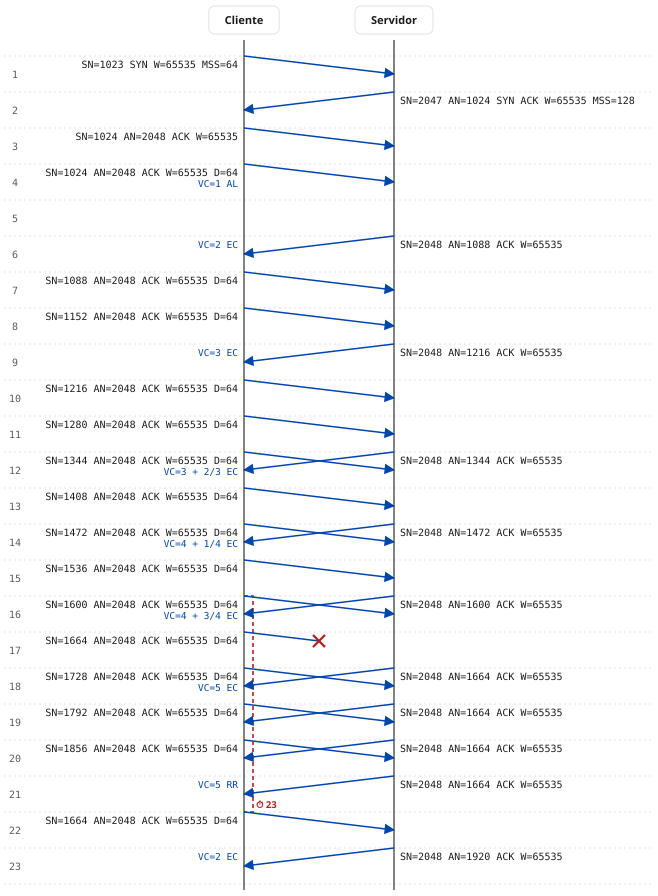
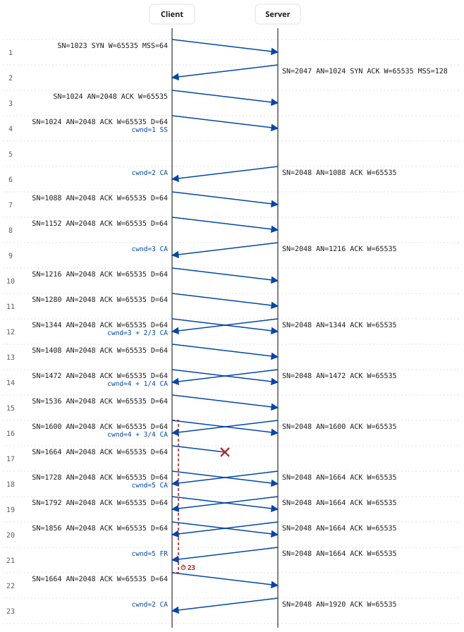

# Diagrama del modo aula: ejemplo comentado

[English](#english) | [Español](#español)

Ficheros de este ejemplo, generados con el comando de más abajo:

| Fichero | Contenido |
| :--- | :--- |
| [`ejemplo-aula.pcap`](ejemplo-aula.pcap) | La captura, para abrirla en Wireshark |
| [`ejemplo-aula.csv`](ejemplo-aula.csv) | El registro del estado interno del emisor |
| [`ejemplo-aula.svg`](ejemplo-aula.svg) | El diagrama con rótulos en español (`--diagram-lang es`, el valor por defecto) |
| [`classroom-example.svg`](classroom-example.svg) | El mismo diagrama con rótulos en inglés (`--diagram-lang en`) |

---

<a name="español"></a>
## Español

### El comando

Es el ejemplo 3 del README, con la opción `--diagram` añadida:

```bash
python tcp_trace_generator.py 14 \
  --classroom --classroom-rto-slots 4 \
  --loss 11 --accept-out-of-order \
  --client-isn 1024 --server-isn 2047 \
  --client-mss 64 --server-mss 128 \
  --ssthresh 2 \
  -o ejemplo-aula.pcap --rto-log ejemplo-aula.csv \
  --diagram ejemplo-aula.svg
```

Catorce segmentos de 64 octetos, el undécimo se pierde, el receptor almacena lo que llega fuera de orden, umbral inicial de 2 segmentos y RTO de 4 ranuras.

### El diagrama



### Cómo leerlo

- **Un tic es una ranura del modo aula**: `RTT / 2`, es decir, 0,05 s con el RTT de 0,1 s del script. El tic *n* empieza en el instante `(n − 1) · 0,05` s de la captura. La latencia es `RTT / 4`, medio tic: cada flecha sale al comienzo de su tic y llega a mitad.
- **Etiquetas**: `SN` número de secuencia, `AN` número de reconocimiento, flags activos, `W` ventana anunciada, `MSS` solo en los SYN y `D` octetos de datos. Los números son absolutos, como en Wireshark con *Relative sequence numbers* desactivado.
- **En azul, bajo las flechas del cliente**, la ventana de congestión del emisor cada vez que cambia, en segmentos y con la notación de clase: `VC=3 + 2/3 EC` es una parte entera de 3 y dos de los tres asentimientos que hacen falta para llegar a 4. Modos: AL arranque lento, EC evitación de la congestión, RR recuperación rápida.
- **Llave roja** en el lado del cliente: el temporizador de retransmisión que cubre el segmento perdido. Continua hasta el tic en que vence, si llega a vencer; punteada hasta la retransmisión, si esta llegó antes, con el tic en que habría vencido (⏱).

### Tic a tic

| Tics | Qué pasa | Qué se ve en Wireshark |
| :--- | :--- | :--- |
| 1–3 | Apertura en tres vías. El SYN consume un número de secuencia: los datos empiezan en 1024 y 2048. | Tramas 1–3. El SYN no lleva opción SACK, por eso luego habrá ACK duplicados y no bloques SACK. |
| 4 | Primer segmento de datos con `VC=1 AL`. | Trama 4, a 0,150 s. |
| 5 | Nada. El receptor espera un tic por si llega otro segmento (ACK retardado). | Un hueco de 0,05 s sin tramas. |
| 6 | Vence la espera: ACK de 1088. El emisor pasa de 1 a 2 y, como alcanza el umbral, entra en EC: `VC=2 EC`. | Trama 5 a 0,275 s: la captura es del lado del cliente, así que el ACK aparece cuando llega, a mitad de tic. |
| 7–8 | Dos segmentos seguidos. El ACK acumulativo del segundo sale inmediato (regla de un ACK cada dos segmentos). | Tramas 6–8. |
| 9–16 | Evitación de la congestión: la VC sube 1 por cada VC asentimientos (`3`, `3 + 2/3`, `4 + 1/4`, `4 + 3/4`). | Un ACK por cada dos segmentos. En el gráfico *Stevens* la pendiente crece despacio. |
| 17 | **Se pierde** el undécimo segmento, SN 1664. La llave empieza en el 16, cuando el último ACK nuevo rearmó el temporizador. | La trama 19 está en la captura (se captura antes del punto de pérdida), pero ningún ACK la cubre. |
| 18 | Llega el ACK de 1664 que confirma hasta el hueco: `VC=5 EC`. El receptor ya ha almacenado 1728. | Trama 21. |
| 19–21 | Cada segmento posterior al hueco provoca un **ACK duplicado inmediato** con `AN=1664` y la misma ventana. | Tramas 23, 25 y 26: *Duplicate ACK (#1)*, *(#2)* y *(#3)*. |
| 21 | Tercer ACK duplicado: **retransmisión rápida**. Umbral = 5/2 = 2, `VC=5 RR` (umbral + 3). | — |
| 22 | Se retransmite SN 1664. La llave acaba aquí, punteada: el temporizador habría vencido en el 23. | Trama 27: *suspected retransmission*. En *Stevens* es el punto que vuelve hacia abajo. |
| 23 | ACK acumulativo de 1920: el hueco se rellena y el receptor confirma todo lo almacenado. La VC se desinfla al umbral: `VC=2 EC`. | Trama 28. En *Window scaling* / *Throughput* se ve el salto del acumulado. |

Para cotejar la captura con el diagrama, añadir en Wireshark una columna con `frame.time_relative` y convertir cada instante en tic con `⌊t / 0,05⌋ + 1`. Los segmentos del cliente caen justo al comienzo del tic; los del servidor, a mitad, porque la captura está en el cliente.

---

<a name="english"></a>
## English

### The command

README example 3 with the `--diagram` option added. The English diagram is the same run with `--diagram-lang en`:

```bash
python tcp_trace_generator.py 14 \
  --classroom --classroom-rto-slots 4 \
  --loss 11 --accept-out-of-order \
  --client-isn 1024 --server-isn 2047 \
  --client-mss 64 --server-mss 128 \
  --ssthresh 2 \
  -o classroom-example.pcap --rto-log classroom-example.csv \
  --diagram classroom-example.svg --diagram-lang en
```

Fourteen 64-byte segments, the eleventh is lost, the receiver buffers out-of-order data, initial threshold of 2 segments and an RTO of 4 slots.

### The diagram



### How to read it

- **A tick is one classroom slot**: `RTT / 2`, i.e. 0.05 s with the script's RTT of 0.1 s. Tick *n* starts at `(n − 1) · 0.05` s of the capture. Latency is `RTT / 4`, half a tick: every arrow leaves at the start of its tick and arrives half way through it.
- **Labels**: `SN` sequence number, `AN` acknowledgement number, active flags, `W` advertised window, `MSS` only on SYNs and `D` data bytes. Numbers are absolute, as in Wireshark with *Relative sequence numbers* turned off.
- **In blue, under the client's arrows**, the sender's congestion window whenever it changes, in segments: `cwnd=3 + 2/3 CA` is an integer part of 3 plus two of the three acknowledgements needed to reach 4. Modes: SS slow start, CA congestion avoidance, FR fast recovery.
- **Red brace** on the client side: the retransmission timer covering the lost segment. Solid up to the tick in which it expires, if it does; dashed up to the retransmission if that came first, labelled with the tick in which it would have expired (⏱).

### Tick by tick

| Ticks | What happens | What Wireshark shows |
| :--- | :--- | :--- |
| 1–3 | Three-way handshake. The SYN consumes a sequence number: data starts at 1024 and 2048. | Frames 1–3. The SYN carries no SACK option, hence duplicate ACKs later instead of SACK blocks. |
| 4 | First data segment, `cwnd=1 SS`. | Frame 4, at 0.150 s. |
| 5 | Nothing. The receiver waits one tick for a second segment (delayed ACK). | A 0.05 s gap with no frames. |
| 6 | The wait expires: ACK 1088. The sender goes from 1 to 2, reaches the threshold and enters CA: `cwnd=2 CA`. | Frame 5 at 0.275 s: the capture is taken at the client, so ACKs appear when they arrive, mid-tick. |
| 7–8 | Two segments in a row. The cumulative ACK for the second is immediate (one ACK every two segments). | Frames 6–8. |
| 9–16 | Congestion avoidance: cwnd grows by 1 every cwnd acknowledgements (`3`, `3 + 2/3`, `4 + 1/4`, `4 + 3/4`). | One ACK per two segments. The *Stevens* graph slope grows slowly. |
| 17 | The eleventh segment, SN 1664, **is lost**. The brace starts at 16, when the last new ACK restarted the timer. | Frame 19 is in the capture (captured before the loss point) but no ACK ever covers it. |
| 18 | ACK 1664 arrives, acknowledging up to the gap: `cwnd=5 CA`. The receiver has already buffered 1728. | Frame 21. |
| 19–21 | Every segment beyond the gap triggers an **immediate duplicate ACK** with `AN=1664` and the same window. | Frames 23, 25 and 26: *Duplicate ACK (#1)*, *(#2)* and *(#3)*. |
| 21 | Third duplicate ACK: **fast retransmit**. Threshold = 5/2 = 2, `cwnd=5 FR` (threshold + 3). | — |
| 22 | SN 1664 is retransmitted. The brace ends here, dashed: the timer would have expired at 23. | Frame 27: *suspected retransmission*. In *Stevens* it is the point that drops back. |
| 23 | Cumulative ACK 1920: the gap is filled and the receiver acknowledges everything buffered. cwnd deflates to the threshold: `cwnd=2 CA`. | Frame 28. The jump is visible in the *Window scaling* / *Throughput* graphs. |

To match the capture against the diagram, add a `frame.time_relative` column in Wireshark and convert each time into a tick with `⌊t / 0.05⌋ + 1`. Client segments fall exactly at the start of a tick; server segments half way through, because the capture point is the client.
